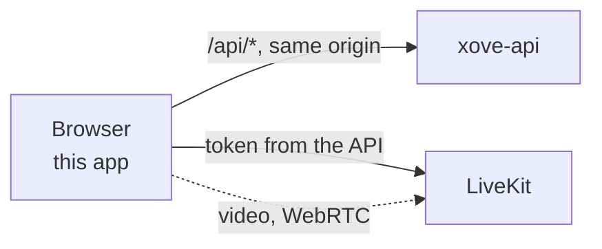
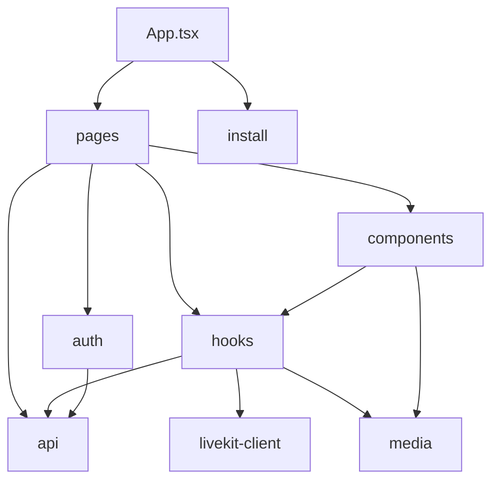
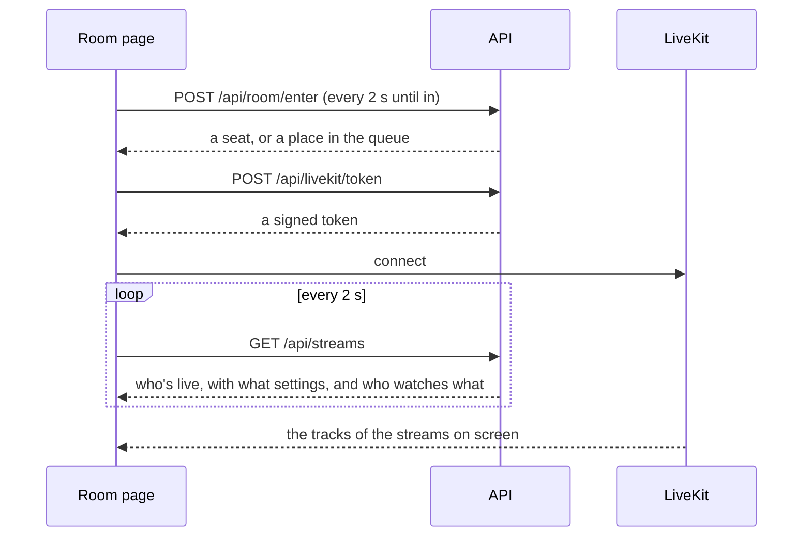

# Architecture

How the web app is built: its modules, its routes, how the room keeps its state, how it talks to the API and to LiveKit, and how it picks a layout for the device. How screens and cameras are sent and played is in [Media](media.md); how everything looks is in the [design sheet](design.md). The API (its endpoints, the room's rules, the data and its security) is in [`xove-api`](https://github.com/Hbrauveres/xove-api/blob/main/docs/README.md).

## Its place



A single-page app (React 19, TypeScript, Vite, React Router, CSS modules) built to static files. It holds no secret and reads no setting: who you are, what you may do and which streams are live all come from the API at run time; the video comes from LiveKit, a WebRTC server that receives each stream once and forwards it to every viewer.

## Modules

Everything is in `app/src`:

| Folder | Owns |
| --- | --- |
| `api/` | The HTTP client (`client.ts`) and the API's types (`types.ts`): one function per endpoint, the CSRF header, errors as `ApiError` |
| `auth/` | Who is signed in (`AuthProvider`, which asks `GET /api/me` once and on demand) and the route guards (`guards.tsx`) |
| `pages/` | One component per route: `HomePage`, `RequestAccessPage`, `RoomPage`, `AdminPage`, and `InstallPage` |
| `hooks/` | The room's state and the browser's: the seat and the queue (`useRoomSeat`), the streams (`useStreams`), the LiveKit connection (`useLiveKitRoom`), both put together for the room (`useRoomSession`), who's on the stage (`useStagePick`), the layout (`useRoomLayout`), swipes (`useStageSwipe`), the video's shape (`useVideoShape`), the round buttons' row holding the clicked button still (`usePinnedRow`), and small ones (`useElapsed`, `useFullscreenElement`, `useInstalled`) |
| `media/` | How screens and cameras are sent (`shareSettings.ts`), the ambilight's drawing (`ambilight.ts`), who is big by default (`stagePick.ts`), choices kept in the browser (`preferences.ts`) |
| `components/stage/` | The player and what's on it: the stage, the ambilight, the round buttons (their icons in `icons.tsx`, the ones that come and go in `ButtonSlot`, the drop-ups on live ones), the volume button and its mixer (`VolumeButton`, `VolumeMixer`: a fixed list of channels, the screen's sound then the voice, one that can't be heard drawn greyed; the stage owns whether it's open, so it and the settings close each other), the settings panel (`SettingsPanel`, and `makeRoom`, which moves the player up for its sheet in the upright full view), the facecam, the previews, the phone's feed and row, the empty stage, the info row; in a phone's upright full view the fullscreen button and the round buttons are drawn on the stage itself, at the bottom of the screen, and `makeRoom` lifts them above the settings sheet; in the upright normal view it lifts them over the video, inside the player, where a tall player reaches under the sheet |
| `components/room/` | The room around the stage: header, footer, people, activity (pill, bell, list), account menu, the waiting screen and the seat offer |
| `components/ui/` | Shared controls: `Button`, `Range`, `Dropdown`, `Segmented`, `Picker` (a list that floats over its panel, masking what's behind it in the nearest `[data-list-host]`; it opens on request too), `DropUp` (its gestures can redirect to an open panel), the cue (`cue.module.css`), `Avatar`, `PersonAvatar`, `LiveDot`, `FullPageMessage`, `Toast` (a short message any component shows with `showToast`) |
| `components/brand/`, `brand/` | The mark: its geometry and animation timeline (`brand/`), and the components that draw it (`XoveMark`, `XoveIcon`) |
| `install/` | Phones and tablets: which device it is, and the browser's install prompt |
| `styles/` | The design tokens (`global.css`) and the tests that check them |
| `test/` | The test helpers: a fake API, a fake LiveKit, and rendering the app at a URL ([Testing](testing.md)) |

At the top, `main.tsx` starts the app (and listens for the install prompt first), `App.tsx` holds the routes, and `types.ts` the room's shared types (a person, a stream, a sharer).



Pages put the room together; components draw it; hooks own the state and talk to the API and LiveKit (the simpler pages call the API directly); `media/` holds the rules for sending and drawing video, as plain functions that hooks and components share. Each component has its own CSS module, using the tokens in `styles/global.css`.

## Routes

`App.tsx` maps each route to a page behind a guard:

| Route | Guard | Shows |
| --- | --- | --- |
| `/` | signed out (signed-in people are sent on) | What Xovê is, "Continue with Google" |
| `/request-access` | signed in, not a member | "You need access", an optional message, the request; a pending state that checks every 20 s and moves you in when approved; a declined state that lets you ask again |
| `/room` | members | The room |
| `/admin` | admins | Pending requests (approve, decline) and members (remove) |
| anything else | | Back to `/` |

Sign-in is the API's: "Continue with Google" goes to `/api/oauth2/authorization/google`, and the API sends you back to `/room` or `/request-access`. The guards only read `AuthProvider`'s answer, so a member page never renders for someone who isn't one.

**On a phone or tablet in a browser tab**, the app shows only `InstallPage` instead of any route: Xovê is used from the home screen there, so sign-in happens inside the installed app. A device counts as touch-first when its main pointer is coarse (`pointer: coarse`); the home-screen app is recognised by its display mode (`useInstalled`: `fullscreen` or `standalone`, or `navigator.standalone` on iPhone).

## The room's state

The room page combines two sources:

- **The API** decides who has a seat and which streams are live. The page asks it every 2 seconds.
- **LiveKit** carries the video and knows who is connected right now.



| State | Owned by | Lives |
| --- | --- | --- |
| My seat, or my place in the queue and the seat offer | `useRoomSeat` | The API; the page polls every 2 s while it waits |
| The live streams, their settings, who watches what | `useStreams` | The API; polled every 2 s by every open room |
| Who is connected, their tracks, my own captures | `useLiveKitRoom` | LiveKit |
| Who's on my stage | `useStagePick` | This page only |
| The layout | `useRoomLayout` | This page, from media queries |
| How I send (quality, mode, the camera picked), my volume (the screen's sound in the mixer), the ambilight's settings | `media/preferences.ts` | The browser (`localStorage`, `xove.*`) |
| Whether the settings are open, the setting a live button asked for, and the camera's preview | `RoomPage`, `useRoomSession` | This page only |

**Waiting for a seat.** The queue's rules (who's next, how long a place and an offer last) are the API's ([how](https://github.com/Hbrauveres/xove-api/blob/main/docs/architecture.md#seats-and-the-queue)). Without a seat, the waiting screen shows the place in the queue and asks again every 2 seconds; that poll is also how the API knows the page is still there. When a seat is offered, a popup counts down the seconds the API gives ("Enter room" accepts, "Cancel" leaves the queue), and the tab's title says "Your turn". Closing the waiting page sends `POST /api/room/leave` with `keepalive`, so the request survives the tab closing.

**Who's on the stage.** Each viewer picks who is big: a preview, a card in the phone's feed, or a live stream's line in the activity list (a camera's line puts the camera big). By default, and when the big person stops, it's the person sharing the longest (`media/stagePick.ts`). Once the pick has been still for a second, the page reports it (`PUT /api/streams/watching`), and again when a poll shows the API lost it (after a restart), so the people panel can say who watches whom. Only the page that's really in the video room reports, so a second tab doesn't overwrite it.

**When the API restarts.** The API keeps the room in memory ([how](https://github.com/Hbrauveres/xove-api/blob/main/docs/architecture.md#memory-and-the-database)). After a restart, an open room asks for its seat again on its next poll, with its LiveKit connection, and registers again what it's still sending; if the places filled up meanwhile, it stops sending. Nobody has to reload.

**Reloading while sharing.** The page sees that the API lists a stream of its own that nothing sends, and ends it.

**When a sharer leaves** (closes the tab, loses the connection), LiveKit tells the API, which ends all of that person's streams ([how](https://github.com/Hbrauveres/xove-api/blob/main/docs/architecture.md#livekit)); every room drops them on its next poll, so nobody watches a frozen picture.

## Talking to the API

`api/client.ts` is the only place that calls `fetch`:

- **Same origin, under `/api`.** In development, Vite forwards `/api` to a local API ([Getting started](getting-started.md)); on the servers, a reverse proxy does.
- **The session cookie** goes with every request (`credentials: "same-origin"`); the app never sees it.
- **CSRF:** every `POST`, `PUT` and `DELETE` copies the readable `XSRF-TOKEN` cookie into an `X-XSRF-TOKEN` header. Another site can't read the cookie, so it can't forge the header.
- **Errors** come as RFC 9457 problem details; the client throws an `ApiError` with the status and the API's `detail` as its message (or a plain fallback per status), and the pages show that message.
- **A 401 from `GET /api/me`** means signed out: `AuthProvider` shows the home page.

Every endpoint, who may call it and what it answers, is in [`xove-api`'s API page](https://github.com/Hbrauveres/xove-api/blob/main/docs/api.md). A web release that needs a new API field ships only once that API version is live, and the app still works without the field.

## LiveKit in the browser

`useLiveKitRoom` joins the video room for as long as the room page is open:

1. It asks the API for a token (`POST /api/livekit/token`), which names this person (`user-<id>`), the room and what they may send: a screen with its sound, a camera, and a microphone (this app sends none yet).
2. It connects with `adaptiveStream` and `dynacast` on ([Media](media.md#what-a-viewer-downloads)).
3. It keeps React state in step with LiveKit's events: who joins and leaves, which tracks arrive, the connection's state ("reconnecting" while LiveKit retries).
4. Leaving the page disconnects. **One connection per person:** opening the room on a second device disconnects the first.

**Sound.** Browsers block sound that starts without a tap on the page, so the first tap or key in the room unlocks it (`room.startAudio()`), and LiveKit plays what was silent.

Sharing a screen or a camera is in [Media](media.md).

## Layouts

`useRoomLayout` picks one of three layouts and follows the screen as it turns or the window resizes:

| Device | Upright | Sideways |
| --- | --- | --- |
| Phone: touch-first, shorter side ≤ 500 px | `upright` | `sideways` |
| Tablet: touch-first, larger | `upright` | `desktop` |
| Anything else | `upright` if the window is ≤ 760 px wide and upright | `desktop` |

`layoutFor` is a plain function of four media queries, so its tests cover every device without a browser. On a tablet held upright, the info row and the feed sit in a column at most 640 px wide. What each layout looks like is in the [design sheet](design.md#screens-and-layouts); how the code keeps them smooth:

- **The stage never moves in the page.** Turning or resizing changes the layout around it, so the video and a share go on without reloading.
- **The stage hugs the picture.** `useVideoShape` reads the big video's width ÷ height from its `resize` event (ignoring changes under 1%), and the stage sizes itself from it in container units, inside a 16:9 box.
- **Swipes** (`useStageSwipe`): left and right change who's on the stage, in the feed's order and wrapping around; the picture follows the finger, and a drag under a quarter of the width springs back unless it was a quick flick. Sideways, a swipe up opens the streams row and a swipe down closes it. Drags that start on a control (`data-no-swipe`) are the control's.
- **Fading:** what fades over a playing stream is marked `data-fades`; the stage hides it after `CHROME_IDLE_MS` without a touch or a move ([how it looks](design.md#motion)).
- **No pull-to-refresh in the room:** while the room is open (`data-room`), the page sets `overscroll-behavior: none`, so a drag down never reloads it.
- **The full-screen view** is the room's own state (`fullView` in `RoomPage`), not the browser's fullscreen: on a phone, and a tablet held upright, the stage's fullscreen button shows the sideways layout while the device stays upright, and turning doesn't change it ([how it looks](design.md#phone-sideways)). Elsewhere the button uses the browser's fullscreen.

**Installing.** On Android, "Get Xovê" opens the browser's install prompt, caught as the page loads (`install/prompt.ts`), since a browser offers it only once; with none, it points to the browser menu's "Install app". On iPhone and iPad, it shows Safari's Share steps. The manifest (`public/site.webmanifest`) has what Chrome checks before offering an install and `"display": "fullscreen"`, so the app opens without a browser bar.

## Repository layout

```
app/                  the web app: everything its image is built from
  src/                the modules above
  public/             the favicon, the phone icons, site.webmanifest
  Dockerfile, Caddyfile, caddy/   the image: the Vite build served by Caddy, built from source
  compose.yaml        runs the image (locally and in the checks)
  scripts/            brand-icons.mjs (the favicon from the mark's geometry)
docs/                 these pages, and the design sheet's pictures
.github/workflows/    the commit checks and the releases
```

## Security, the web app's side

- **No secrets:** the app holds none; what a member may do always comes from the API, which checks it again on every request ([`xove-api`'s security](https://github.com/Hbrauveres/xove-api/blob/main/docs/security.md)).
- **CSRF:** the header on every change, as above.
- **The image** is a static build served by Caddy as a non-root user, and every change passes a vulnerability scan of the image and the dependencies, and a static analysis of the code, before it can be merged (`.github/workflows/ci.yml`).
