# Design sheet

Everything Xovê looks like, in one place: the name, the mark, the icons, the colours, the type, the shapes and motion, every control, and each screen on desktop, tablet and phone. It's the reference for new work: **use what's here before adding anything new**, and update this page in the same PR when the look changes.

The pictures are shot from the real app (`design-sheet.mjs`, see [Keeping this page current](#keeping-this-page-current)). The values come from the code: `app/src/styles/global.css` (the tokens), `app/src/brand/` (the mark) and each component's CSS module.

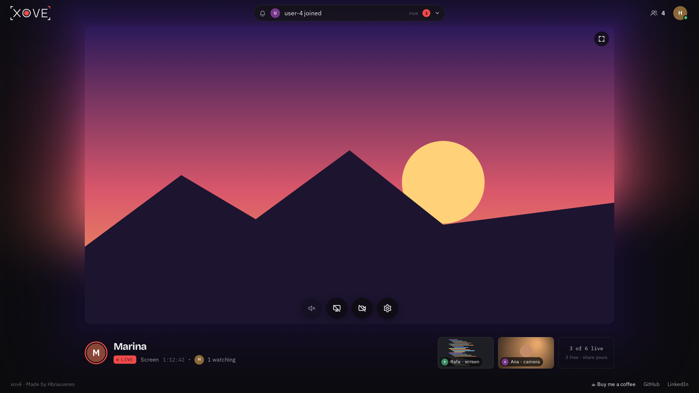

## Contents

- [Name and voice](#name-and-voice)
- [The mark](#the-mark)
- [Icons and favicon](#icons-and-favicon)
- [Colour](#colour)
- [Type](#type)
- [Shape and spacing](#shape-and-spacing)
- [Motion](#motion)
- [Controls](#controls)
- [Notifications and status](#notifications-and-status)
- [Screens and layouts](#screens-and-layouts)
- [Accessibility](#accessibility)
- [Rules for new work](#rules-for-new-work)
- [Keeping this page current](#keeping-this-page-current)

## Name and voice

- **Xovê**, with the circumflex, in every sentence and label. `xove` only where an accent can't go: the domain (`xove.app`), repos, code, image and container names. The wordmark is written in capitals, **XOVE**, and its red corner stands in for the ^.
- **Short, plain sentences**, in sentence case: "Share your screen", "Full-screen view", "Nobody live · 0 of 6 · 6 free", "Xovê works best from your home screen". No exclamation marks, no jargon.
- **Say what happens, then what to do:** "The room is full. You're 2nd in line." A disabled control says why in its tooltip.
- **The middle dot (·)** joins short facts on one line: "Marina · Screen", "3 of 6 live · 3 free".
- **Every control has a spoken name** (`aria-label`) that says what it does or what it shows: "Watch Rafa's screen", "4 people here", "Marina: account, connected".

## The mark

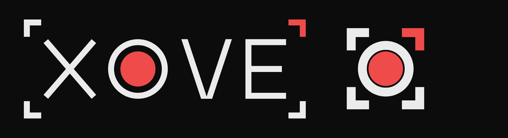

- **The wordmark:** [XOVE] in a slim viewfinder. The O is a record button: a white ring as thick as the letters and a red dot inside. Four corners frame the word; the **top-right corner is red**.
- **The symbol:** the record O alone, inside the same four corners. It's the app icon and the favicon.
- **Construction** (`app/src/brand/mark.ts`, the only place the geometry lives): one grid with a cap height of 100 and a stroke of 10. Letter widths X 88, O 100, V 90, E 68, gaps 20. The viewfinder sits 28 from the letters, with arms of 24 (26 in the symbol). The dot's radius is 29.4 in an O 100 across. The X ends square, the V's tips are cut flat at the cap height.
- **Colours:** white strokes (`--text`, `#ebebec`), the red dot and corner (`--accent`, `#ef4b4b`), on the soft black ground. Never recoloured, outlined, stretched or put on a busy picture.
- **Drawn, not typed:** `components/brand/XoveMark` (the wordmark, inline SVG, named "Xovê" for screen readers) and `XoveIcon` (the symbol). In the header it's about 110 px wide.
- **The hover animation** (`brand/markTimeline.ts`, `useMarkAnimation`): pointing at the wordmark (or focusing it) plays it once, in about 3 seconds. The left corners stay and the word slides under them until the X is gone, while the right corners close in on the O; the corners settle into the symbol; the dot double-blinks like a surprised eye; everything plays back. A new hover doesn't restart it, and it never plays with reduced motion.
- **Three optical sizes of the symbol** (`iconMark("large" | "small" | "tiny")`): **large** (64 px and up) is slim, about 70% of its square; **small** (32 px) and **tiny** (16 px) have heavier strokes and fill more of the square, tiny edge to edge. The outer edges match in all three.

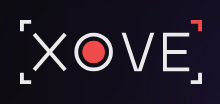

## Icons and favicon

| File | What | Notes |
| --- | --- | --- |
| `app/public/favicon.svg` | The tiny symbol, for the tab and bookmarks | Its white parts turn soft black when the browser is in light mode (a `prefers-color-scheme` rule inside the file); the red stays |
| `apple-touch-icon.png` | iPhone home screen | The large symbol on the soft black ground |
| `icon-192.png`, `icon-512.png` | Android home screen, install prompt | Same |
| `icon-maskable-512.png` | Android's shaped icons (circle, squircle) | The mark sits inside the 80% safe circle (its farthest pixel 191 px from the centre, the safe radius 205) |
| `site.webmanifest` | Name, icons, `theme_color` and `background_color` `#0c0c0d`, `display: fullscreen` | Opened from the home screen, no browser bar |

`node scripts/brand-icons.mjs` (from `app/`) rewrites the favicon from `mark.ts`; `--maskable` renders the maskable icon, and `--phone` prints the SVG the phone icons are rendered from. A test fails if the favicon drifts from the geometry.

**Interface icons** are drawn inline as SVG in the components, on a 20 × 20 grid (12 × 12 for the small arrows), with round 1.5–2 px strokes in `currentColor`, so they take the colour of their button. There's no icon library: a new icon follows the same grid and stroke.

## Colour

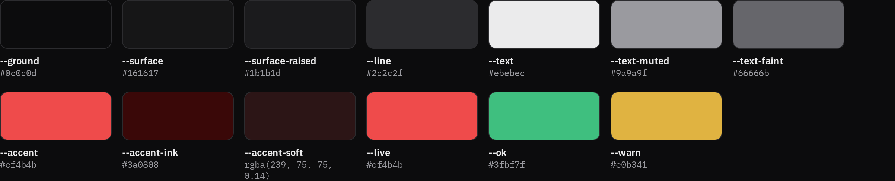

Dark only: Xovê is a room for watching screens, so the chrome stays out of the way of whatever is on the stage.

| Token | Value | Use |
| --- | --- | --- |
| `--ground` | `#0c0c0d` | The page: soft black |
| `--surface` | `#161617` | Panels |
| `--surface-raised` | `#1b1b1d` | Raised surfaces, hovers on ghost buttons |
| `--line` | `#2c2c2f` | Borders and dividers |
| `--text` | `#ebebec` | Text, white strokes, the mark |
| `--text-muted` | `#9a9a9f` | Secondary text |
| `--text-faint` | `#66666b` | Labels that can be faint (3:1 at least) |
| `--accent` | `#ef4b4b` | **The one accent**, red, the record light: live pills, on-air rings, the unseen count, focus rings, the switch when on, primary buttons |
| `--accent-ink` | `#3a0808` | Text and icons on a red fill (4.7:1) |
| `--accent-soft` | `rgba(239, 75, 75, 0.14)` | Soft red glows and tints |
| `--live` | `#ef4b4b` | LIVE, the live dot, danger buttons |
| `--ok` | `#3fbf7f` | Connected, the seats bar |
| `--warn` | `#e0b341` | Reconnecting |
| `--glass` | `rgba(10, 10, 11, 0.72)` | The round buttons, drop-ups and pickers over the video (with an 8 px blur) |
| `--panel` | `rgba(18, 18, 20, 0.74)` | The settings panel (with a 22 px blur) |
| `--panel-line` | `rgba(255, 255, 255, 0.08)` | The panel's border and its tabs' line |
| `--sel-bg` | `var(--surface-raised)` | The dark pill of a chosen option, and buttons in a row (Change) |
| `--sel-shadow` | `0 1px 2px rgba(0, 0, 0, 0.4)` | Its shadow |
| `--sel-hover` | `#26262a` | A button in a row, pointed at |

- **Pure black `#000` only behind the video:** the stage, the previews, the facecam and the camera's preview in the settings, as the picture's own frame. Nowhere else.
- **Red is rare on purpose:** it means the brand or something live. Sliders are white and the switch is grey until it's on.
- **Avatars** without a photo get the person's own hue: `hsl(<hue> 42% 38%)` with a white initial.
- **The empty stage's colour bars** keep their colours, at full strength, and the ambilight glows from them.
- **The ambilight** takes its colour from the picture, never from the palette.
- **Contrast:** every text colour reaches 4.5:1 on every surface, 3:1 for faint labels. `styles/palette.test.ts` computes it and rejects the old palettes (amber, blue-tinted greys).

## Type

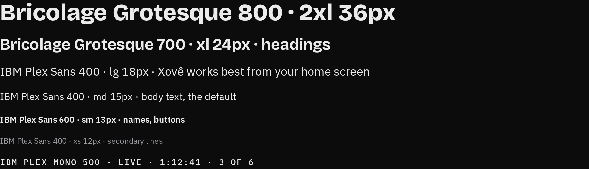

| Font | Token | Use |
| --- | --- | --- |
| **Bricolage Grotesque** 500 / 700 / 800 | `--font-display` | Headings, the name of who's on the stage, big statements ("The stage is yours.") |
| **IBM Plex Sans** 400 / 500 / 600 | `--font-body` | Everything else: body, buttons, names in lists |
| **IBM Plex Mono** 400 / 500 | `--font-mono` | Counters and times: LIVE, `1:12:41`, "3 of 6 live", section labels like "LIVE NOW" |

| Size token | rem | px | Typical use |
| --- | --- | --- | --- |
| `--text-xs` | 0.75 | 12 | Secondary lines, timestamps |
| `--text-sm` | 0.8125 | 13 | Names in rows, small buttons, captions |
| `--text-md` | 0.9375 | 15 | Body (the default), buttons |
| `--text-lg` | 1.125 | 18 | Stage messages, dialog titles |
| `--text-xl` | 1.5 | 24 | Page headings |
| `--text-2xl` | 2.25 | 36 | The largest headings |

Body line height is 1.5; headings balance their lines (`text-wrap: balance`). Fonts load from Google Fonts with `display=swap`; fallbacks are Segoe UI and the system sans.

## Shape and spacing

| Token or value | Use |
| --- | --- |
| `--radius-sm` 6 px | Buttons, the facecam, small boxes |
| `--radius-md` 10 px | Cards, dialogs (the seat offer) |
| 16 px | Dropdown panels |
| 999 px (pill) | Round buttons, the activity pill, badges, dots |
| `--gutter` 16 px | The page's side margin, and the minimum on a phone |

- **Frosted glass** for things floating over the stage or the page: dark at 72–74% with a blur (8 px for the round buttons, 22 px for panels).
- **Clear cuts:** stacked panel sections are separated by a 2 px gap that shows the page behind, never a drawn line.
- **Touch targets** are at least about 36 px (the switch keeps a 36 × 20 px target; the stage's dots an 18 px one around a 6 px dot).

## Motion

| What | Duration | Easing |
| --- | --- | --- |
| Button hover and press | 120 ms (press moves 1 px down, 80 ms) | ease |
| A round button coming or going: width and gap | 220 ms | `cubic-bezier(0.2, 0.8, 0.2, 1)` |
| …its fade | in 160 ms after 80 ms, out 140 ms | ease |
| The round buttons' row back to the centre, once the pointer leaves | 220 ms | `cubic-bezier(0.2, 0.8, 0.2, 1)` |
| Slider knob growing | 120 ms | — |
| Switch knob | 180 ms | ease |
| Stage dots | 180 ms | ease |
| Dropdown unroll and roll back | 260 ms, by its height | `cubic-bezier(0.2, 0.8, 0.2, 1)` |
| The settings panel coming in and going out (over the cog: a fade and a 6 px rise; the sheet from the bottom) | 140 ms fade, 180 ms rise; the sheet 260 ms | `cubic-bezier(0.2, 0.8, 0.2, 1)` |
| The toast coming in and going out (a fade and a 6 px drop), and how long it stays | 160 ms fade, 200 ms drop; stays 3 s | `cubic-bezier(0.2, 0.8, 0.2, 1)` |
| The settings' tab marker; a segmented control's pill | 200 ms | `cubic-bezier(0.2, 0.8, 0.2, 1)` |
| A drop-up: the pause before it unrolls | 120 ms resting on the button | — |
| …its fade and 6 px slide up | 140 ms and 180 ms; a slip outside shorter than 300 ms doesn't close it | ease, `cubic-bezier(0.2, 0.8, 0.2, 1)` |
| A picker's chevron turning | 200 ms | `cubic-bezier(0.2, 0.8, 0.2, 1)` |
| A list unrolling from its pill, its options fading in by their distance (40 ms apart), and rolling back | 220 ms; 150 ms back | `cubic-bezier(0.2, 0.8, 0.2, 1)`; ease-in back |
| The soft light behind an option pointed at | 160 ms | ease |
| The player moving up for the settings sheet (upright full view) and back | 260 ms | `cubic-bezier(0.2, 0.8, 0.2, 1)` |
| A new activity in the pill | 350 ms | ease |
| Facecam buttons fading | 250 ms | ease |
| The stage resizing to a new picture | 350 ms | ease |
| Controls over a playing stream | fade after about 2.5 s without a touch or mouse move; back on any move | — |
| The ambilight following the picture | 120 ms time constant, with the screen's refresh (at most 60 a second) | — |
| The live dot's ping | 1.8 s, looping | ease-out |
| The mark's hover animation | about 3 s, once | — |

- **Panels never clip, fade or filter** while they move: that would stop their blur. They unroll by their height.
- **With reduced motion**, every animation and transition is cut to nothing (a global rule), the mark doesn't play, swipes change at once and the ambilight updates every 500 ms. A round button that comes or goes still never moves the one under the pointer.

## Controls

### Round buttons

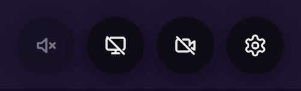

- **48 px** circles in a pill (44 px on a phone held upright, 48 px again in its full-screen view and held sideways), 10 px apart (8 px on the upright phone), dark frosted glass (`rgba(10, 10, 11, 0.72)`, blur 8 px, shadow `0 4px 16px` black at 35%), with a 20 px icon.
- **One state system, on every round button:** **sending** (your screen, your camera) is a red pill (`--accent`) with the plain icon in deep red (`--accent-ink`); **off** is dark glass with the crossed icon in white; **unavailable** is 45% opacity, with the reason in the tooltip. Red means live, nothing else.
- **The icons** (`components/stage/icons.tsx`): the screen is a crossed monitor while you're not sharing, and shows **a screen with an arrow up** while it's pointed at or focused, so it says what a click does (not while it's unavailable); while you share, the plain monitor. The camera is crossed while off, plain while on. The volume is a speaker with its waves, crossed when muted or silent. Settings is **a cog with teeth**.
- **Order**, centred at the bottom of the stage: volume, screen, camera, settings.
- **Plain on/off buttons, no arrows.** A click starts or stops; what you send is set in the [settings panel](#the-settings-panel), and while a stream is live, resting the mouse on its button unrolls its [drop-up](#drop-ups). With a mouse, a live button shows its drop-up instead of a tooltip.
- **Hover:** a glass pill lightens to `rgba(40, 40, 44, 0.85)` in 120 ms (only with a mouse); a red pill and an unavailable one don't change. **Focus** draws one red ring around the pill.
- **Which ones:** sharing my screen and camera, and the cog, always; the volume only while watching someone else. On a phone, which can't share a screen, the screen button is **greyed out**, not hidden: faded, its crossed icon, and "This browser can't share a screen" as its description. In fullscreen they come along, and any error from starting is drawn over the player.
- **Unavailable** (a full room, no sound): 45% opacity, with the reason in the tooltip. A stream without sound shows a crossed, locked volume button ("No sound in this stream").
- **Coming and going without moving what you clicked:** a button that appears or goes (the volume when you start or stop watching someone) opens or closes its width and its gap in 220 ms while it fades (in: 160 ms after 80 ms; out: 140 ms), so its neighbours slide. While a mouse pointer rests on the row, the button under it stays exactly where it is (a touch doesn't stay, so nothing is held); once the pointer leaves, the row glides back to the centre in 220 ms.
- They fade with the rest of the controls while a stream plays, and come back on any move.

### Segmented controls

`components/ui/Segmented`: every choice between a few options (Quality, Mode) is one.

- A light translucent **track** as tall as the panel's controls, and **one dark pill** (`--sel-bg`, a 1 px inner line, `--sel-shadow`) that slides under the chosen option in 200 ms.
- An option pointed at gets **a soft light that fades only sideways** (white at 6% in the middle, nothing at its ends, the track's full height), fading in 160 ms, and its text goes from muted to white. **The chosen option doesn't react**: it's already chosen.
- Plain labels ("Smooth", "Sharp"), with what each does in its tooltip. A radio group: the arrow keys move the choice, with one tab stop.

### Pickers

`components/ui/Picker`: every choice from a list (which camera) is one, in any panel or over the video.

- **Closed:** a pill as tall as the other controls, the chosen option and a small chevron.
- **Open, it's one box with its pill:** the pill grows into the list with **no gap and no separate floating box**, in the pill's own colour. **The chosen option stays in the pill and isn't repeated**; the others follow in rows as tall as the pill, their text lined up with the pill's.
- **Every list floats:** nothing moves when one opens. **In a panel** it opens down over the controls under it, in the pill's own see-through colour: what's **right behind it is hidden** while it's open, so through it shows only the panel's frosted glass (a blur can't be told to skip what's under it), and what's **just under its bottom edge fades back in over 30 px**, starting 4 px below it, nearly invisible near the list (8% halfway, 35% at three quarters) and fully there at 30 px. Nothing else hides. **Over the video, it grows upward** in the pill's glass, never taller than the room above it.
- **A long list has a scrollbar:** after three and a half options it scrolls, with the app's slim scrollbar (4 px, no arrows) inside the list, its track kept clear of the rounded corners. A row's hover light (white at 5%) stays inside its row, so a short list never scrolls.
- **It unrolls** from its pill (upward from a drop-up's) in 220 ms, each option fading in as the edge reaches it, the nearest first, and **rolls back** in 150 ms; with reduced motion it just appears and goes.

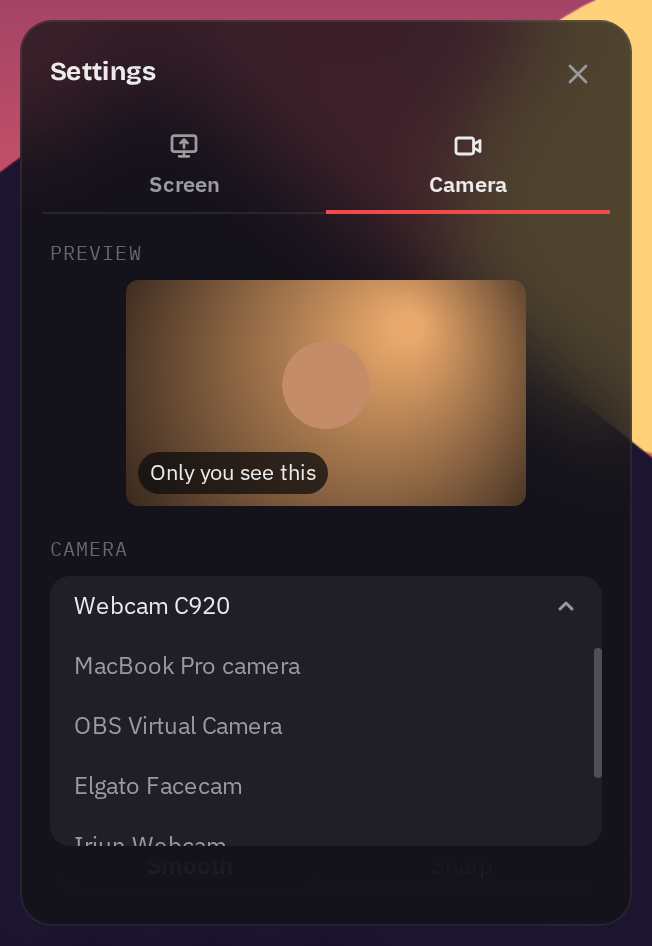
- The arrow keys move through it; Escape or a click outside closes it.

### Drop-ups

`components/ui/DropUp`: quick access to a live button's most used action, where the pointer already is. Any later quick action follows these rules.

- **Resting the mouse on a live round button** unrolls one frosted pill above it, centred, after **120 ms**: the round buttons' glass, blur and shadow, **with no box around it**. It fades and slides 6 px; nothing blurred is animated.
- **Moving up into it keeps it open** (the gap is bridged), and on into an open list inside it. It closes when the pointer leaves, its list with it, **also right after a click**; a slip outside shorter than **300 ms** doesn't close it. Keyboard focus opens it; a click's focus doesn't keep it open.
- **By touch, press and hold the live button for 500 ms** (a long press, as on any phone): it opens and **stays open** after the finger lifts, until a tap outside it, its action done (a camera picked, Change), or the button pressed again. A finger that moves is scrolling, not holding. The button offers no text selection or long-press menu, and by touch the drop-up's controls are 44 px.
- **The button's own click or short tap still does what it always does** (stop the stream).
- **Screen:** what's shared ("A window", "A tab" or "Your whole screen") and **Change**. **Camera:** the camera's picker, growing upward. Their controls are 36 px tall, with 12 px text.

### The settings panel

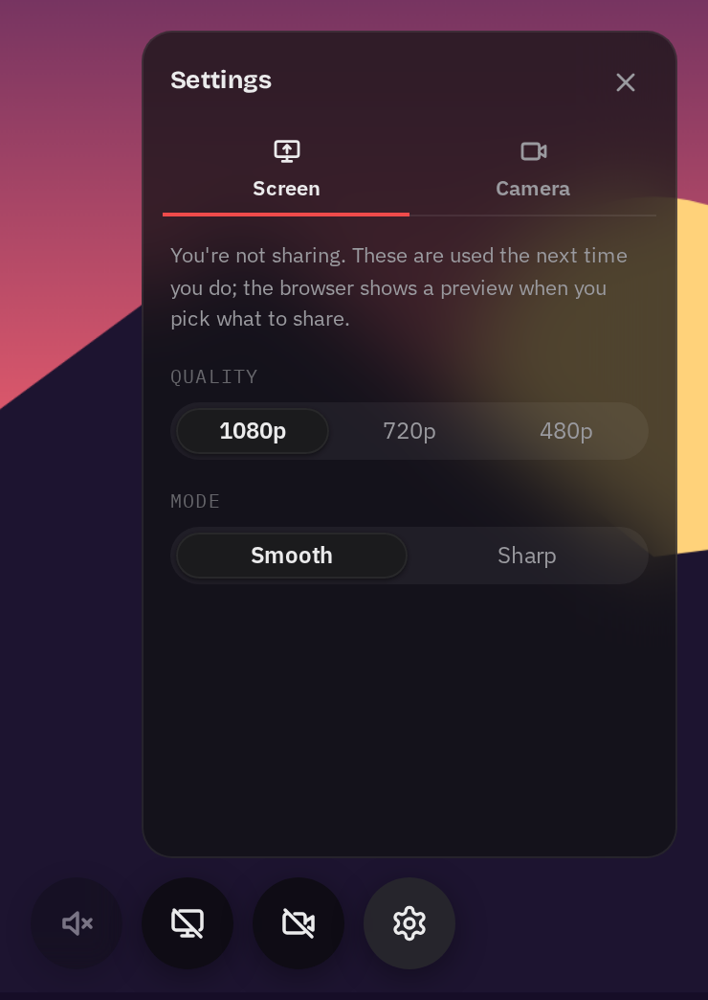 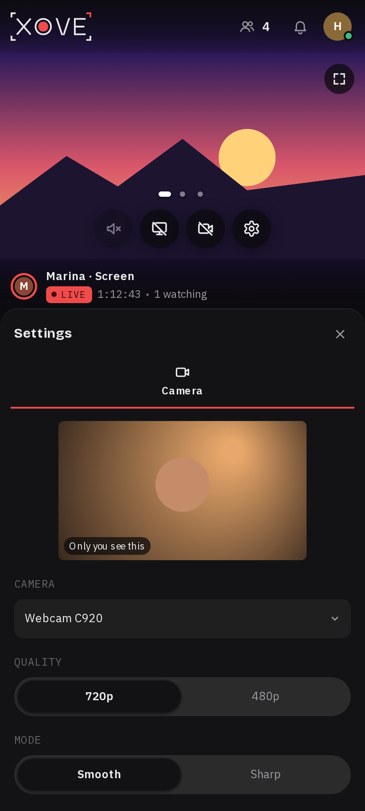 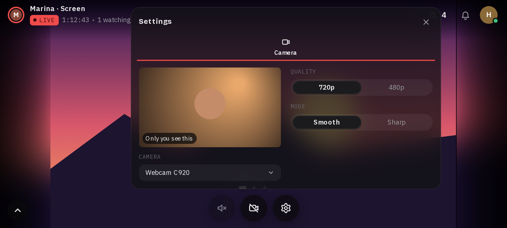

The settings for what you send, from the cog.

- **Desktop, tablets and phones held sideways: over the cog.** A popover **centred on the cog**, like the volume's slider, **10 px above the round buttons** (never behind them) and never past the player's sides; it fades in and rises 6 px. **Every tab has the same height**, the tallest one's, so switching tabs never moves the tabs under the pointer; at least 240 px, at most the room above the buttons (then it scrolls inside). Its width follows the player: a fifth of it, **280 to 320 px**. **Sideways it uses the width:** up to 560 px, in **two columns**, what you pick on the left (the preview and the camera, the window) and how it's sent on the right (Quality, Mode), so no tab scrolls. **One panel over the buttons at a time:** while it's open, the volume's slider stays closed. **A phone held upright** (its full-screen view too): a **bottom sheet**, no pull handle; the ✕, the cog or Escape closes it.
- Frosted like the dropdown panels (the panel colour at 74%, blur 22 px, a 1 px white border at 8%), 16 px corners (20 px on top of the sheet). **One control height:** 30 px over the cog, 44 px in the sheet.
- **Tabs Screen and Camera**, with a **red marker** that slides under the chosen one and a **red dot** on the tab of what you're sending. **On phones the Screen tab is greyed out**, as anywhere a screen can't be shared: it stays in its place, says why ("This browser can't share a screen"), and the panel opens on Camera.
- **Screen:** while you share, what's shared and **Change** (and, when the screen has no sound, a line saying how to share it); while you don't, one line saying these are used next time. **No preview**: the stage and the browser's picker already show it. Then Quality and Mode.
- **Camera:** your camera's preview under its own **Preview** heading, like every other group, centred under it: **LIVE** while it's sent, **"Only you see this"** while it's off (the camera turns on for you alone while the tab is open). Like any app, the browser asks for the camera the first time; refused or missing, the preview's place says so, and how to allow it. Then the camera's picker, Quality and Mode. **Sideways**, the preview is alone in the left column; the camera's picker, Quality and Mode are in the right one.
- **No field descriptions**, except where a setting needs a line to make sense. The body scrolls with the app's slim scrollbar, without arrows.
- **In the upright full view, the sheet makes room instead of covering:** the player, its round buttons with it, moves up at the same size between the top bar and the sheet. If it doesn't fit (a vertical share), the video stays under the sheet and the round buttons alone move up just above it: **the buttons are never left behind the settings.** The video is never shrunk; everything slides back when the sheet closes.
- **Panels open over the button that opened them** (a rule for the whole app): the settings over the cog, the volume over its button, the drop-ups over their live buttons. Nothing slides in from a side.

### Buttons

| Variant | Look | Use |
| --- | --- | --- |
| Primary | Red fill, deep-red text; lighter red (`#f36a6a`) on hover | The one main action on a page ("Get Xovê", "Request access") |
| Ghost | Transparent, muted text, a `--line` border; raised surface on hover | Secondary actions |
| Danger | Transparent, red text and a red border at 55% | Removing a member, stopping |

Two sizes: **md** (10 × 18 px padding, 15 px text) and **sm** (6 × 12 px, 13 px). Weight 600, `--radius-sm`, 45% opacity when disabled.

### Sliders

`components/ui/Range`, white like a video player's: a **3 px track**, white up to the knob and `#ebebec` at 22% after, and a **12 px white knob** that grows to 14 px on hover or keyboard focus. Used for the ambilight's brightness, the stage's volume (vertical, sliding up from the volume button while it's pointed at) and each preview's volume (horizontal). WebKit has no part for the filled side, so `Range` sets a `--fill` variable; Firefox uses `::-moz-range-progress`.

### Switch

A slim grey track (**36 × 14 px**, `#3a3a3d`) that looks the same off and on, and a **20 px knob** that overhangs it: `#bdbdc0` when off, red when on, sliding in 180 ms. The ambilight's on/off in the account menu. **In a panel, a switch row** (a label, its description, the switch at the right) **sits 5 px in** from the edge the headings and boxes share, so its text doesn't sit on it.

`styles/controls.test.ts` checks the sliders' and the switch's values.

### Dropdown panels

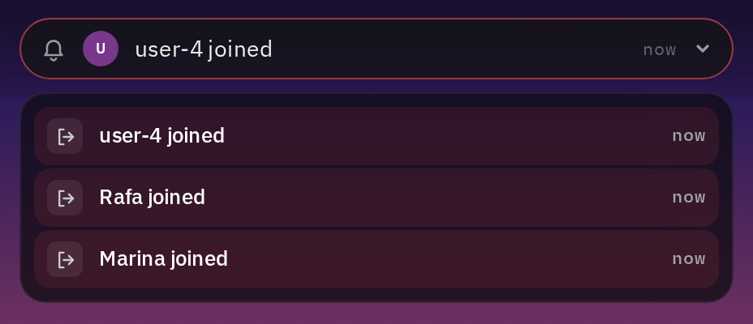

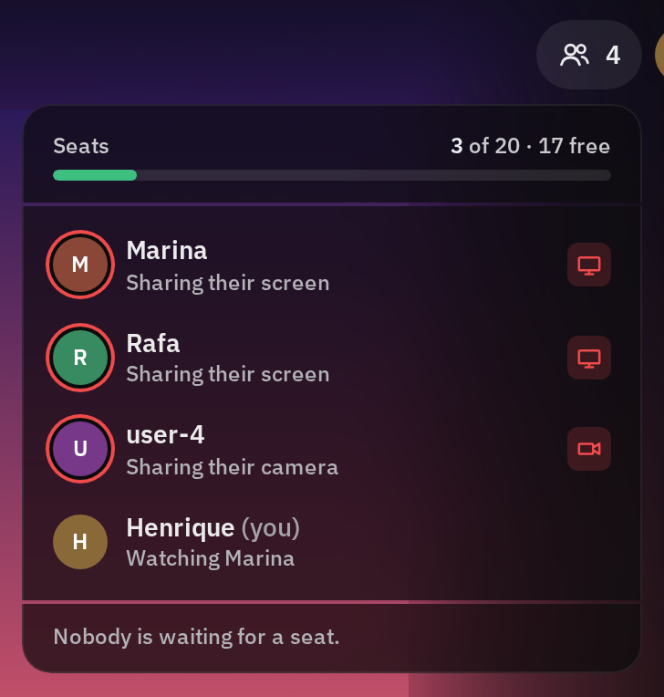 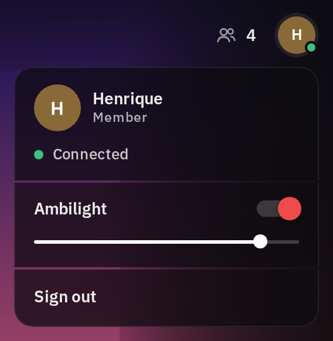

- Frosted sections (dark at 74%, blur 22 px, a 1 px white border at 8%), **16 px corners**, stacked with 2 px clear cuts. 340 px wide (the activity list: up to 440 px, centred under the pill).
- Open 8 px under their button; **one at a time**; they unroll by their height (260 ms).
- **Activity:** the latest events, each with its icon, what happened and when. **People:** the seats bar (green), who's here and what each is doing or watching, and the queue. **Account:** me and my connection, the ambilight's switch and brightness, Admin for admins, Sign out; on a phone, the footer's links at the end.
- Sideways on a phone they're as tall as the screen allows and scroll inside.

### Avatars and LIVE

- **Avatars:** round, the person's photo or their hue with a white initial (`hsl(<hue> 42% 38%)`), weight 700.
- **On air:** a red ring with a ground-coloured gap, outside the avatar in lists and **inside its edge** in the info row, so its outer edge stays the avatar's.
- **LIVE badge:** a filled red pill with a deep-red dot and "LIVE" in mono, next to the stream's kind and its running time.
- **The live dot:** 8 px red, with a ring that pings outward every 1.8 s.

### On the stage

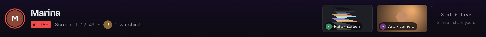

- **The info row:** on the left, who's on the stage (avatar with its ring, name in the display font, LIVE, what, how long) and who's watching (up to 4 avatars and "N watching", me included, never the sharer); on the right, the other streams as **previews** with a name chip (their screen, or their camera when that's all they share), then a dashed box "N of 6 live · N free · share yours", gone when all 6 are live. When room runs short, the left gives way first, then the previews scroll with a slim scrollbar, and the box stays put.
- **The facecam:** the camera as a small window over the screen, 24% of the player's width, `--radius-sm`, with 28 px round buttons (swap views, collapse) that fade with the controls; collapsed, a 28 × 44 px tab at the right edge. It **starts at the top right** (just under the top bar where one lies over the player), clear of the round buttons and the fullscreen button. It can be dragged, or moved with the arrow keys. Swapping also works on your own preview; the swap and the collapse last for the visit only.
- **The fullscreen button has one place:** the **bottom right** of the player, its centre level with the round buttons, to enter and to leave, on desktop and phones alike, over a stream and over the empty stage, so stopping the only stream in fullscreen (or in a phone's full view) never strands you there. Held sideways, a phone has none: the room is always in the full view.

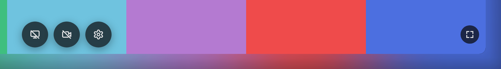
- **Stage dots** (phone, more than one live): 6 px dots just above the round buttons, the current one stretched to 14 px; a tap jumps to that person.

## Notifications and status

- **The activity pill** (desktop header, centre): 38 px tall, up to 440 px wide, frosted. It shows the latest event with its person and time, and a **red count** (18 px pill) of the ones not seen yet. A click opens the activity list; a live stream's event puts it on the stage.
- **The bell** (phone): the same list, with no count or dot, between the people button and my account.
- **Losing the connection** takes over the pill: **yellow** (`--warn`), with a 12 px spinner, until it's back. The account button's dot is green when connected.
- **Stage messages** (`StageNotice`): centred over the stage, a title in `--text-lg` and a line under it (up to 42 characters wide, `--text-sm`), with a 22 px spinner while something loads ("Loading Marina's screen…").
- **The seat offer:** when a seat frees up for someone in the queue, a dialog (up to 400 px, `--radius-md`) offers it for 60 seconds, with the time running down.
- **The waiting room:** the place in the queue, in plain words, while the room is full.
- **Tooltips** say why a control can't be used, with a mouse or the keyboard (a finger leaves a button "hovered" after a tap, so touch screens don't show them on hover).
- **The toast** (`components/ui/Toast`, called with `showToast`): a short message to the user, the app's one way to announce something briefly. The round buttons' glass (frosted, 8 px blur, their shadow), a pill up to 360 px wide and two lines, 13 px text, with the icon of what it's about (the control you touched, crossed out) and no alert sign. At the top centre of the player; on a phone held sideways and in the full view, the top centre of the screen, over the top bar's empty middle. It fades in and drops 6 px, stays **3 s** and fades out by itself; one at a time, the newest replacing it; screen readers hear it once. Today it says why a greyed-out control can't be used when a finger or a pen touches it ("This browser can't share a screen", the full room).

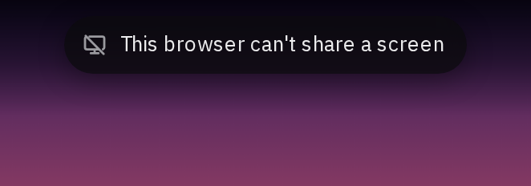

## Screens and layouts

### Which layout

Three layouts: the **desktop's** (theater mode), the **upright view** (phones held upright, tablets held upright, narrow upright windows) and the **sideways view** (phones held sideways). Which device gets which, and the sizes that decide it, are in [Architecture](architecture.md#layouts).

Turning switches layouts at once, and the stage keeps its place in the page, so the video never reloads. Phones and tablets use Xovê only as a home-screen app; in a browser tab they see the install screen.

### Desktop: theater mode

- **Header** (see-through, full width): the wordmark, the activity pill in the centre, the people button and my account on the right. **Footer:** plain muted text, "Made by Hbrauveres", and white "Buy me a coffee" among muted links.
- **The stage** fills a 16:9 box as big as the window allows, and **hugs the picture**: a wider picture keeps the full width and gets shorter, a taller one keeps the full height and gets narrower, centred, with no black bars. On a window taller than 16:9 (a vertical monitor), the box may take all the height above the info row, so portrait pictures fill it. Empty and loading stages are 16:9.
- **The ambilight** glows around the stage from the picture's edges, soft and slow.
- **The info row** under the stage is exactly as wide as the 16:9 box.

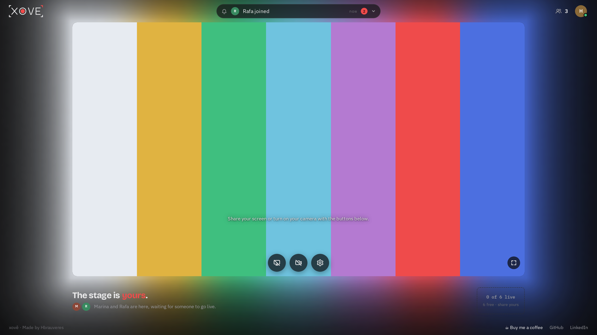

**Nobody live:** colour bars on the stage (full colour, lit by the ambilight), "The stage is yours." and the round buttons to start.

### Phone, upright

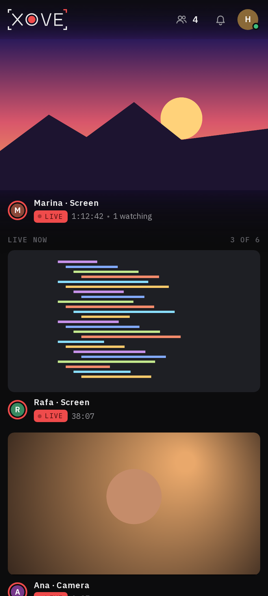 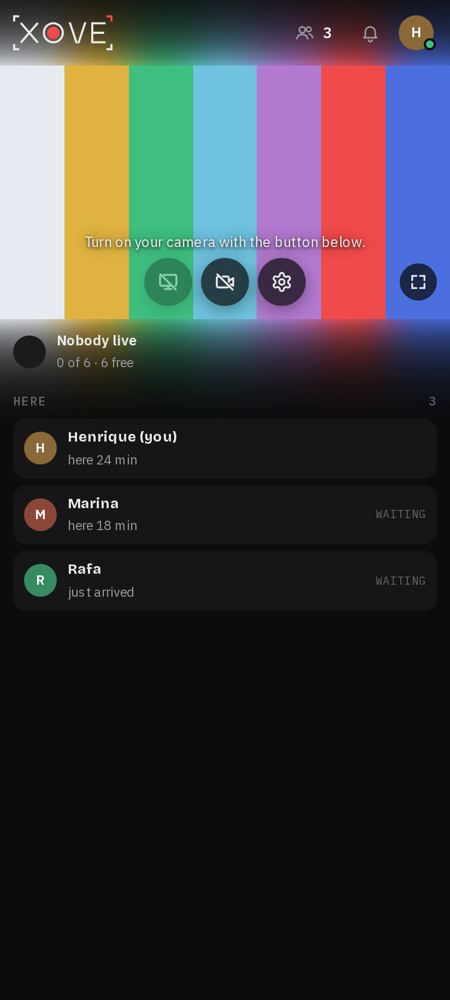

- **Top bar:** the wordmark; the people button, the bell and my account on the right. No footer: its links end the account menu.
- **The stage** edge to edge under the top bar, never taller than 60% of the screen, with the round buttons and the dots on it; a swipe left or right changes who's on it.
- **Under it, the only part that scrolls:** "LIVE NOW · 3 OF 6" and the other streams as a **feed** of full-width pictures, each with the compact info row; a tap puts one on the stage. With nobody live: who's here as **cards**, with how long each has been here.

### Phone, sideways

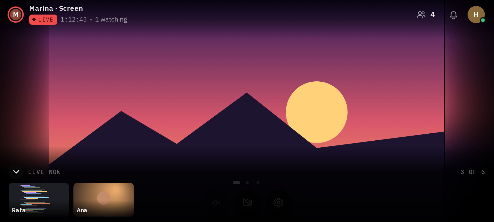

- **No header or footer:** the stage fills the height and hugs the picture, black at its sides where the light glows.
- **A top bar** over a black gradient: who's on the stage on the left; the people button, the bell and my account on the right.
- **The round buttons** at the bottom; a round arrow button at the bottom left opens the **streams row** (small silent pictures with names, over a black gradient), as does a swipe up.
- **The settings** open over the cog in two columns, so they fit the short screen without scrolling: on Camera, the preview alone on the left, the camera's picker, Quality and Mode on the right.
- Everything fades about 2.5 s after the last touch while a stream plays, and an open streams row closes with it.
- **The full-screen view:** upright, the fullscreen button shows this same layout without turning the phone; turning doesn't change the choice.

### Tablet, upright

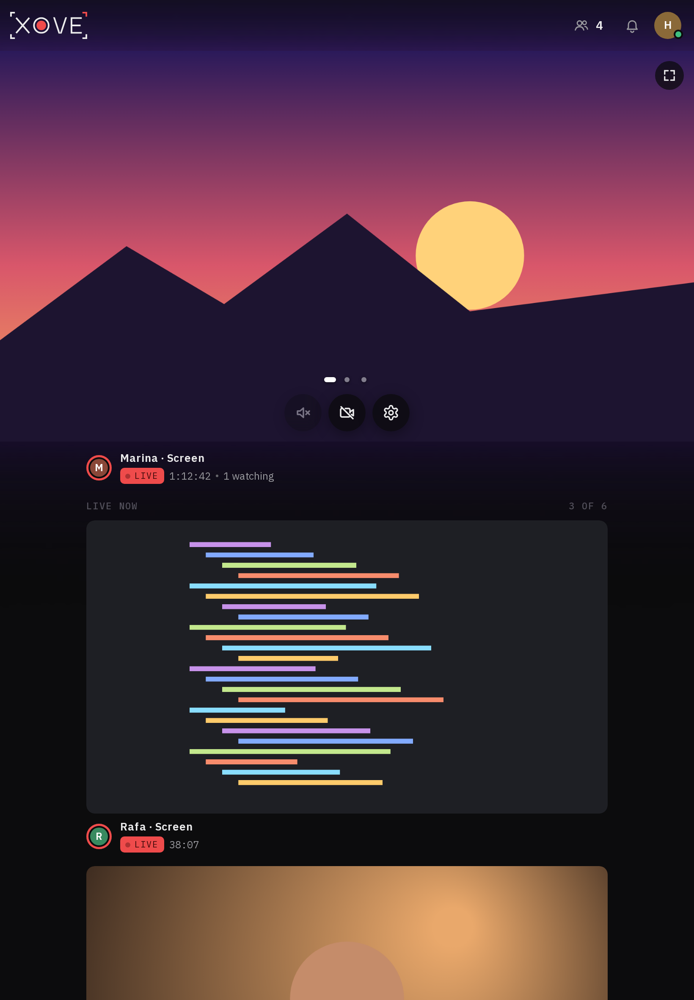

The phone's upright view, with the stage full width and the info row and feed in a centred column up to 640 px wide. Sideways, a tablet gets the desktop layout.

### The install screen

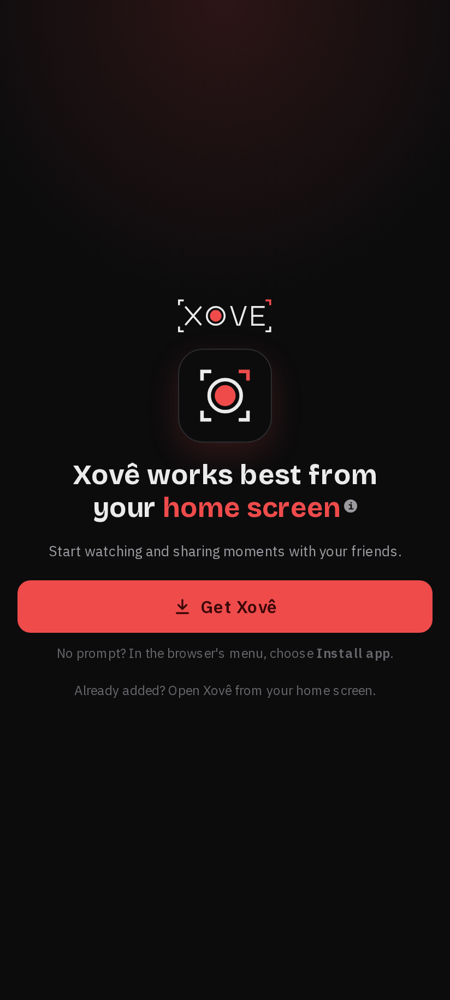 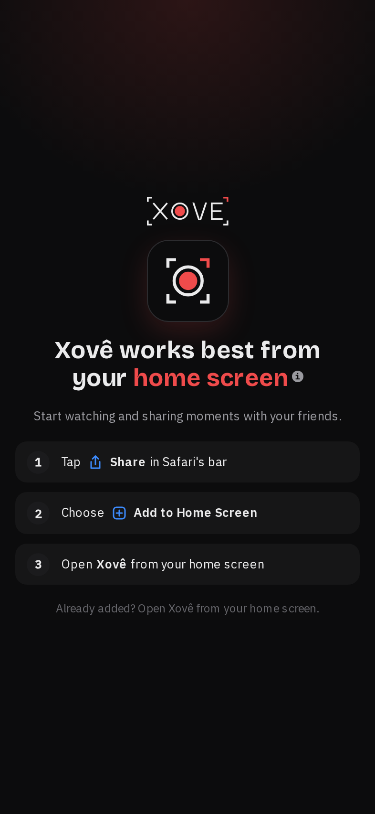

What a phone or tablet sees in a browser tab, on every page: the wordmark, the symbol in a rounded tile with a soft red glow, the headline "Xovê works best from your **home screen**" (the last words in red) with a small "i" that shows why, and the action. **Android:** a primary "Get Xovê" button (the browser's install prompt) and a hint for the browser's menu. **iPhone and iPad:** Safari's three Share steps. Centred, with a soft glow from the top that fades out before the wordmark.

## Accessibility

- **Focus is always visible:** a 2 px red ring, 2 px out (3 px around the round buttons' pill, white 4 px out around sliders).
- **Keyboard:** every control is a real button or input; the volume opens on focus; the facecam moves with the arrow keys; Escape closes panels.
- **Names:** every control and picture has a spoken name; the mark is "Xovê"; videos are named by whose stream they are.
- **Contrast** as in [Colour](#colour), checked by a test.
- **Reduced motion** as in [Motion](#motion).

## Rules for new work

- **Use the tokens.** A new colour, size or font is a design decision: it needs an approved draft first, then it lands in `global.css` and here.
- **Red means the brand or live.** Don't use it for anything else.
- **Unavailable, not hidden.** An option that can't be used here stays in its place, greyed out (the faint text colour at 50%), with its reason in its tooltip, so a panel looks the same on every device.
- **Draft first:** a visual change starts as a clickable HTML draft with these tokens and fonts, approved before the work starts. The approved draft is the reference the code must match.
- **Check every size:** desktop 1920 × 1080, vertical monitors (1080 × 1920 and 1440 × 2560), a narrow window, phones upright (412 × 915, 360 × 740) and sideways (915 × 412, 667 × 375), tablets (820 × 1180, 1180 × 820), the empty room and the install screen.
- **Reuse the components:** `RoundButton` styles, `Button`, `Range`, the switch, `Dropdown`, `Segmented`, `Picker`, `DropUp`, `Avatar`, `LiveDot`, `StageNotice`, `Toast`. A new control follows their sizes, motion and focus ring. A choice from a list is a `Picker` (one box, floating, with the slim scrollbar when long), a few options a `Segmented`, and a quick action over a live button a `DropUp`, everywhere in the app.
- **Panels open over the button that opened them,** never from a side; on a wide, short player they use the width (two columns) rather than scroll. **Panels are frosted, never opaque**; nothing over the video hides the round buttons.
- **Say what effects cost:** blur, canvases and animations run on every frame; keep them to what's here.

## Keeping this page current

The pictures are shot from the real app, with fake people and moving pictures, by a script that drives a headless browser through every screen and size (it lives with the project's tooling, outside this repo). After a visual change, retake them and update the text in the same pull request.
