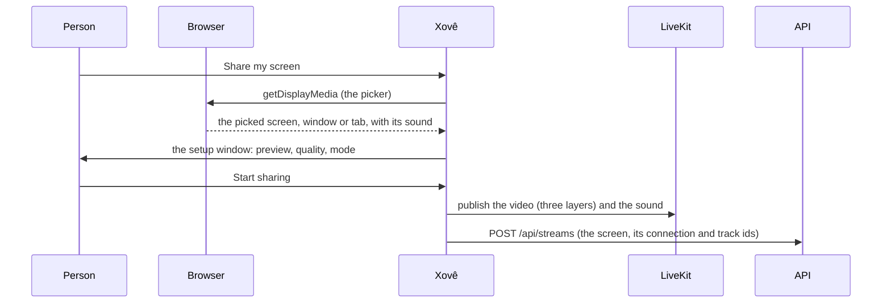

# Media

How the web app sends a screen or a camera, how it plays what others send, and how the ambilight is drawn. The rules live in `app/src/media/` as plain functions with their own tests; `hooks/useLiveKitRoom.ts` applies them to LiveKit. The room's state and the LiveKit connection are in [Architecture](architecture.md); how the controls look is in the [design sheet](design.md).

LiveKit's defaults suit slides and voice calls: 15 fps, sharpness first, voice filters on the sound. Xovê is for games and videos, so it changes most of them.

## Sending a screen

1. **The picker.** Xovê opens the browser's picker itself (`getDisplayMedia`) instead of through LiveKit, because `livekit-client` drops the `windowAudio` option. It always captures the best quality, 1080p at 30 fps, so the sharer can raise the quality later without picking again. It can't pick its own tab (that would show the room inside the room). In Chrome, it asks the browser to stay on Xovê after the pick (`CaptureController.setFocusBehavior`), so the sharer sees the setup window instead of jumping to the shared window.
2. **The setup window** shows a preview and the settings. Nothing is sent until "Start sharing"; closing the picker or the window sends nothing.
3. **Publishing** sends the tracks to LiveKit, then tells the API, which lists the stream for everyone. Up to 6 streams are live at once (someone with a screen and a camera uses 2); with 6 live, the start buttons wait: nobody is pushed out. A phone that can't share a screen offers only the camera.

**Which sound comes along:**

| Picked | Sound sent |
| --- | --- |
| A window | Only that app's sound (`windowAudio: "window"`), not Discord's or the system's |
| A tab | That tab's sound |
| The whole screen | The system's sound, without Xovê's own (`restrictOwnAudio`), so viewers don't hear their own streams back |

Sound is captured as music: no echo cancellation, no noise suppression, no automatic volume, in stereo, and sent at 128 kbit/s without silence skipping (`dtx: false`, which chops quiet moments). Whether a share has sound depends on the browser and the system: Chrome offers it for a tab, for a window where the system supports it, and for the whole screen on Windows; Firefox and Safari offer none. A screen without sound says so in its button's tooltip and menu, and viewers see a crossed, locked volume button.

**While sharing**, the arrow on a stream's button opens its menu:

- **Change window** opens the picker again and swaps the new pick into the same LiveKit track (`replaceTrack`): no setup window, no new stream for the API or the viewers. The sound follows: swapped, added as a new track, or removed.
- **A camera list** switches the camera being sent (`restartTrack` on the same track).
- **Stop**, the lit button or the browser's own "Stop sharing" bar end the stream.

**Cameras** are asked for only on that click, never with the microphone, and go up to 720p: enough for a face, and it spares the upload of someone sending a screen too. They're sent like a screen, with a 720p and a 480p layer.

## Quality and modes

The sharer picks a quality and a mode in the setup window, and can change both while sharing.

| Quality | Size | Frame rate | Up to |
| --- | --- | --- | --- |
| 1080p (the default for screens) | 1920 × 1080 | 30 fps | 8 Mbit/s |
| 720p (the default for cameras) | 1280 × 720 | 30 fps | 4 Mbit/s |
| 480p | 854 × 480 | 30 fps | 2 Mbit/s |

- **Always three layers.** A screen is sent in VP9 (VP8 where the browser can't) as three separate layers, one per quality (`simulcast` with `scalabilityMode: "L1T3"`). The chosen quality is a **cap**: the layers above it aren't sent. So a change of quality is live: same stream, no reload.
- **No tight limits.** The ceilings are well above what a screen usually needs, so only the sharer's and each viewer's computer and connection limit the picture; the browser and LiveKit lower the bitrate themselves when a connection can't keep up. The sharer uploads every layer up to the cap (about 14 Mbit/s at 1080p on a great connection); each viewer downloads one.
- **Two modes:**
  - **Smooth** (games, videos; the default): the track is marked as motion (`contentHint`), and when the connection is tight the picture gets softer while the frame rate holds (`maintain-framerate`).
  - **Sharp** (text, code): marked as detail; the picture keeps its detail and the frame rate drops (`maintain-resolution`).
- **Changing them** from the stream's menu: the sharer's browser applies the new cap and mode right away and tells the API (`POST /api/streams/{kind}/settings`). Every viewer reads the settings with the streams, every 2 seconds, and follows them: its quality menu offers nothing above the cap, and Auto asks for no more than it. Since no viewer asks for the layers above the cap, LiveKit stops sending them (dynacast), and the sharer's upload really drops.
- **Browsers:** Firefox (no VP9) and Safari send a single layer, so viewers get only the sharer's quality and the quality menu offers nothing lower. In Safari, Sharp behaves like Smooth.

## What a viewer downloads

- **The size it shows.** The room connects with `adaptiveStream`: each video is downloaded at the size it's shown, so previews and the facecam come in small. With `dynacast`, layers nobody watches aren't sent at all.
- **A fixed quality.** The viewer's quality menu offers Auto (what fits the player and the connection) or a fixed quality from the sharer's down to 480p. A fixed quality asks LiveKit for that layer, so the viewer really downloads less.
- **Sound.** Only the big person's plays. Previews are muted, each with its own volume; a muted preview's sound isn't downloaded at all, and a preview without sound has no speaker. Someone sharing sees their own streams like everyone else, without their sound. The volume button mutes and unmutes to the same level; there's no slider while muted, without sound, or on iPhones and iPads, which ignore a page's volume.
- **The quality menu** is for the big video; previews and the facecam follow their size.
- **Remembered.** Each browser keeps its choices in `localStorage`: `xove.share.*` (quality, mode), `xove.camera.*` (quality, mode, device), `xove.watch.*` (quality, volume, muted) and `xove.ambilight.*` (on, brightness).

To see what really happens, open `chrome://webrtc-internals` in the sharer's or a viewer's browser: the codec, frame rate, size, bitrate, and why the quality drops ("cpu": the sharer's computer can't keep up; "bandwidth": the connection can't).

## The ambilight

The picture's own edges glow around the stage, like a TV's ambient light. It's drawn by the browser's graphics pipeline and never reads a pixel, so a 4K monitor costs the same as a small window, and a stream the page isn't allowed to read is lit too.

**The canvas** (`media/ambilight.ts`) is small and stretched by the page:

- **A grid of square cells** follows the stage's shape (`gridFor`): 64 × 36 at 16:9, 36 × 64 for a portrait picture, at most 96 along the longer side. Round it, the glow reaches 16 cells, then a 3-cell margin, at 2 px a cell (`glowLayout`).
- **Each update** draws the picture in nine pieces (`edgeDraws`): the whole picture under the stage, its edge strips stretched outward, and its corner patches stretched into the corners. It draws them over the last update at partial opacity, which eases the light with a 120 ms time constant (`easeFor`). Then it blurs the result once and cuts it with a fade mask made once per grid (`fadeMask`): the light falls to exactly zero before the margin, with a fixed grain so it doesn't show bands.

**When it updates** (`components/stage/Ambilight.tsx`): with the screen's refresh (`requestAnimationFrame`, at most 60 times a second), only while the tab is visible, the video plays and the ambilight is on. With reduced motion it updates twice a second instead, a gentle step each time. With nobody live, it lights the empty stage's colour bars: a small still picture drawn once, with no loop.

**What it costs:** one small canvas draw and one blur per frame while a video plays. The ambilight's switch and brightness are in the account menu.
